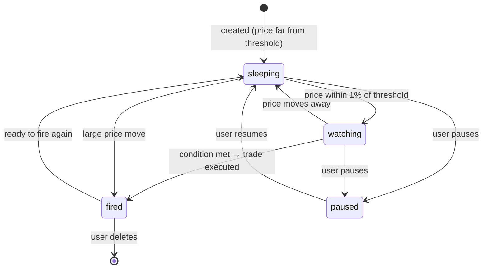
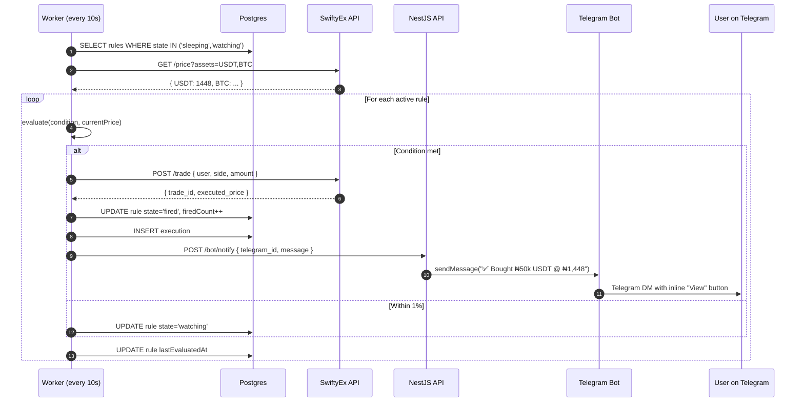
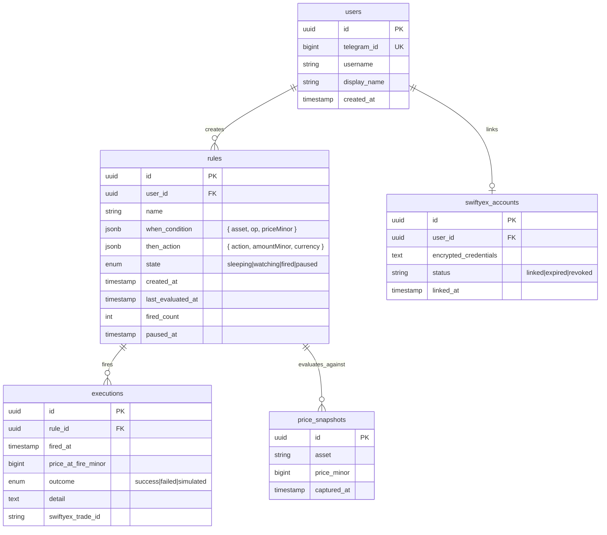
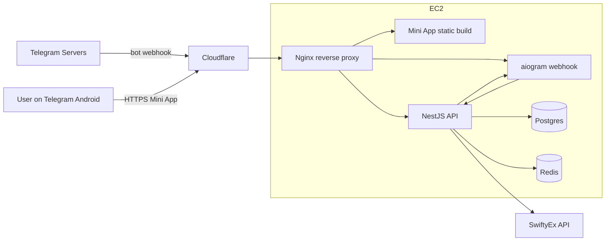

# Swifthum / The Watcher — Architecture

> **SwiftyEx Hackfest Osun 2026** — A Telegram Mini App that lets users build visual "WHEN/THEN" rules for auto-trading naira/USDT on SwiftyEx. *"Cron jobs for your money, designed for humans not engineers."* Android-only for the hackathon demo.

> **Pivoted from ultrasonic payments on 2026-05-22.** Lower wow-factor, higher execution confidence, sponsor-aligned (generates trade volume for SwiftyEx).

---

## 1. System overview

A user opens **@swifthumbot** in Telegram, taps **Open App**, and a Mini App launches showing their rule dashboard. They build a rule visually ("WHEN USDT drops below ₦1,450 → BUY ₦50,000"). The rule sits in the backend; a worker polls SwiftyEx prices on a schedule, evaluates active rules, and fires matching ones. When a rule fires, the backend executes the trade via SwiftyEx and the bot DMs the user with a confirmation.

```mermaid
flowchart LR
    U[User on Telegram Android] -- /start --> BOT[Telegram Bot<br/>Python aiogram]
    BOT -- launch Mini App --> MA[Mini App WebView<br/>Vite + React]
    MA -- CRUD rules + initData --> API[NestJS API]
    API --> DB[(Postgres)]
    WORKER[Worker<br/>poll + evaluate] -. read active rules .-> DB
    WORKER -. price feed .-> SX[SwiftyEx API]
    WORKER -- rule matches --> API
    API -- execute trade --> SX
    API -- notify --> BOT
    BOT -- DM "✅ Bought ₦50k USDT @ ₦1,448" --> U
    API -. AI suggest .-> AI[Claude Haiku]
```

**Key insight:** The Mini App is purely a control surface. The "product" — the watching and firing — lives in a backend worker that runs whether the user has the Mini App open or not.

---

## 2. Repository layout

Polyglot monorepo, Turborepo + pnpm.

```
swifthum/
├── apps/
│   ├── api/        NestJS 11 backend ✅ (hello-world; needs rules + worker)
│   ├── mini-app/   Vite + React Mini App ✅ (Dashboard, RuleBuilder, RuleDetail)
│   └── bot/        Python aiogram bot (skeleton folders, no handlers yet)
├── infrastructure/
│   └── docker-compose.yml   Postgres, Redis, api, worker, bot, mini-app
├── package.json    pnpm workspace root, Turbo scripts
├── pnpm-workspace.yaml ✅
├── turbo.json      ✅ build/dev/lint/test/clean pipelines
└── ARCHITECTURE.md (this file)
```

**Scaffold gaps to close:**
- Backend dev: `apps/api` still hello-world. Needs auth (`POST /auth/telegram`), rules CRUD, worker, SwiftyEx client.
- Bot dev: `apps/bot` folders empty. Needs `/start` handler with Mini App launch button, payment notification webhook from API, reconciled `pyproject.toml` deps.
- Worker location undecided — see §6.

---

## 3. Stack

| Layer | Choice | Status |
|---|---|---|
| **Entry point** | Telegram Bot (Python aiogram 3.x) | Skeleton scaffolded, no handlers |
| **Frontend (Mini App)** | Vite + React 18 + TypeScript + Tailwind v4 | ✅ Built, screens in place |
| **Telegram SDK** | `@telegram-apps/sdk-react@3.3.9` | ✅ Wired (init, theme, haptics, BackButton) |
| **Backend** | NestJS 11 on Express | Skeleton only |
| **DB** | Postgres + Prisma | Not added yet |
| **Cache** | Redis | Not added yet |
| **Worker** | NestJS scheduler (or separate service) | Not built |
| **SwiftyEx client** | TBD — depends on their API | Backend dev's call |
| **AI** | Claude Haiku 4.5 | Not wired |
| **Deploy** | Docker Compose → EC2 → Cloudflare | Not built |

---

## 4. Authentication via Telegram `initData`

**No phone + PIN.** Telegram identifies the user.

When the Mini App opens, Telegram injects `window.Telegram.WebApp.initData` — a signed query string. The backend validates the HMAC against the bot token, upserts a `users` row keyed by `telegram_id`, and returns a session JWT.

```ts
// frontend (already wired in apps/mini-app/src/lib/tg.ts)
const raw = initData.raw();
await api.post('/auth/telegram', { initData: raw });

// backend (to write)
function validateInitData(initData: string, botToken: string): TelegramUser {
  const params = new URLSearchParams(initData);
  const hash = params.get('hash');
  params.delete('hash');
  const dataCheckString = [...params].sort().map(([k, v]) => `${k}=${v}`).join('\n');
  const secret = crypto.createHmac('sha256', 'WebAppData').update(botToken).digest();
  const computed = crypto.createHmac('sha256', secret).update(dataCheckString).digest('hex');
  if (computed !== hash) throw new UnauthorizedException();
  return JSON.parse(params.get('user')!);
}
```

---

## 5. Rule lifecycle



The **worker** is responsible for state transitions. Frontend just renders the current state from the API.

---

## 6. Worker design

The worker is the heart of the product. Three options for where it lives:

| Option | Pros | Cons |
|---|---|---|
| **NestJS scheduled task** in same process | Simple, one deploy | Couples worker downtime to API downtime |
| **Separate Node service** sharing Prisma client | Independent scaling, cleaner separation | Two deploys, two processes |
| **BullMQ + Redis** repeating job | Retry/backoff for free, observable | More infra, overkill for hackathon |

**Recommendation for hackathon:** **Option 1.** `@nestjs/schedule` with a `@Cron('*/10 * * * * *')` task that:

1. Pulls all rules where `state IN ('sleeping', 'watching')`.
2. Calls SwiftyEx for current prices of the assets needed (deduped).
3. For each rule, evaluates the condition.
4. If condition met → executes trade via SwiftyEx → updates rule state to `fired`, increments `firedCount`, inserts an `executions` row.
5. If condition near (within 1%) → transitions `sleeping` → `watching`.
6. Updates `lastEvaluatedAt`.

Post-hackathon: extract to its own service.

---

## 7. Payment / trade flow (the only real workflow)



### Failure modes handled
- **SwiftyEx down** → log + skip evaluation; user sees stale `lastEvaluatedAt` on Dashboard. No false fires.
- **Trade fails** → execution row with `outcome='failed'`; bot DMs user. Rule stays in `watching`.
- **Rule fires repeatedly** → cool-down period (e.g. 5 min between fires of same rule) to prevent runaway.
- **User pauses mid-evaluation** → check `state='paused'` after price fetch, before trade execution.

---

## 8. Security model

| Threat | Mitigation |
|---|---|
| Forged Mini App session | Telegram `initData` HMAC validated against bot token |
| User creates rule for someone else's SwiftyEx account | Rules scoped to `user_id`; SwiftyEx credentials stored per-user, server-only |
| Runaway rule fires draining wallet | Per-rule cool-down (5 min), per-day fire cap (e.g. 10), max amount per rule |
| Forged bot notification webhook | Shared secret between API and bot service |
| Bot impersonation | Telegram bot token + webhook secret |
| SwiftyEx credentials leak | Encrypted at rest, never exposed to frontend |
| Rule injection attack | DSL is a typed JSON schema, no string interpolation |

---

## 9. Data model



**All prices and amounts stored as `bigint` minor units (kobo for NGN).**

---

## 10. AI layer

| Feature | Tier | Trigger |
|---|---|---|
| **Plain-English rule outcomes** | S | When a rule fires, Claude summarises: *"Bought ₦50,000 of USDT at ₦1,448 — ₦12 cheaper than your average."* Bot DM body. |
| **Suggested rules** | S | Dashboard carousel: Claude analyses user's past trades + market history → suggests rules. *"You bought USDT 3 times at ~₦1,450 last month. Want a rule for that?"* |
| **Anomaly detection** | A | If a rule is about to fire at a price 20%+ off recent average → confirmation prompt. |
| **Weekly insights** | A | Bot DM Sundays: *"Your rules saved ₦12,500 vs market average this week."* |

**Cost ceiling:** ~$5 in Claude credits for the hackathon.

---

## 11. API surface (NestJS)

```
POST   /auth/telegram                    { initData } → { sessionToken, user }

GET    /rules                            → Rule[]
POST   /rules                            { name, when, then } → Rule
GET    /rules/:id                        → Rule
PATCH  /rules/:id                        partial → Rule
DELETE /rules/:id                        → 204
POST   /rules/:id/pause                  → Rule
POST   /rules/:id/resume                 → Rule
GET    /rules/:id/executions             → Execution[]

GET    /prices/current                   ?assets=USDT,BTC → { USDT: 145000, ... }
GET    /prices/:asset                    ?range=24h → { points: [{t, priceMinor}] }

GET    /swiftyex/link                    → { authUrl }
POST   /swiftyex/callback                → { status }
DELETE /swiftyex/account                 → 204

GET    /insights/suggested-rules         → Rule[]
GET    /insights/weekly                  → { summary, topRules }

POST   /bot/notify                       (internal, bot↔api auth)

WS     /ws                               rule.state-changed, rule.fired, price.tick
```

All authed endpoints require `Authorization: Bearer <sessionToken>`.

---

## 12. Bot responsibilities (Python aiogram)

| Handler | Trigger | Action |
|---|---|---|
| `/start` | First open | Welcome, "Open App" button (Mini App launch) |
| `/rules` | Text command | Quick text listing of active rules |
| `/pause <id>` | Text command | Pause rule via API |
| `/help` | Text command | How-to message |
| `POST /bot/notify` | From API on rule fire | Sends DM with rich card + inline "View" button |
| Callback `view_rule:{id}` | Inline button tap | Opens Mini App at `/rules/:id` |
| Voice note received | (Future) | Forward to Claude → propose new rule via inline buttons |

Bot exposes an internal HTTP endpoint for the API to push notifications.

---

## 13. Mini App screens (current)

Already built in `apps/mini-app/`:

| Route | Component | Purpose |
|---|---|---|
| `/` | `Dashboard` | Header with USDT price + sorted rule list + "+ New rule" FAB |
| `/rules/new` | `RuleBuilder` | WHEN/THEN form + live preview + Save |
| `/rules/:id` | `RuleDetail` | Rule summary, stats, fire history, pause/delete |

Components: `RuleCard`, `StateBadge`, `EmptyState`. Format helpers: `formatNgn`, `formatPriceMinor`, `formatRelativeTime`, `formatRuleSummary`.

**Currently uses mock data from `src/mocks/rules.ts`.** Swap to real API calls (via `src/lib/api.ts`) when backend lands.

---

## 14. Deployment



Single EC2 instance, Docker Compose. Cloudflare in front for TLS (Telegram requires HTTPS for both Mini App and webhook).

---

## 15. 72-hour build plan

### Day 1 — Foundation
- ✅ Pivot decided. Mini App scaffold already in place.
- **Backend dev — Hour 0–4:** Confirm SwiftyEx API availability. Decide real-API vs mock-prices.
- **Backend dev — Hour 4–14:** Prisma schema (users, rules, executions, swiftyex_accounts). `POST /auth/telegram`. Rules CRUD. Mock SwiftyEx client.
- **Frontend dev — Hour 0–14:** Already done. Wire mocks throughout, build screens against the §5 schema.
- **Bot dev — Hour 4–12:** aiogram setup, `/start` with Mini App launch button, `POST /bot/notify` internal endpoint.
- **All — Hour 14–24:** Worker loop (poll → evaluate → fire). End-to-end mock test.

### Day 2 — Product
- Hour 24–30: Wire real SwiftyEx if API exists; otherwise harden mock.
- Hour 30–40: AI suggested rules (Claude Haiku), insights endpoint.
- Hour 40–46: Polish: animations on state transitions, fire moment, dashboard sort.
- Hour 46–48: End-to-end smoke test inside Telegram on Android.

### Day 3 — Win
- Hour 48–60: Demo mode (seeded rules + scripted fire moment). Polish loading + error states.
- Hour 60–68: Rehearse pitch 30+ times. Record video backup.
- Hour 68–72: Pitch deck, sleep.

**Stop building features at hour 48.**

---

## 16. Demo strategy

**30-second opener:** Don't explain — *do*. Hold up an Android phone, open the bot, tap Mini App, scroll the dashboard showing 4 rules with different states. Tap "+ New rule" — build *"WHEN USDT drops below ₦1,440 → BUY ₦50,000"* in 10 seconds with dropdowns. Save. Then **press the demo trigger** — bot DM appears: *"✅ Bought ₦50,000 USDT @ ₦1,438"*.

**The "wait what?" moment:** *"You just built a no-code trading bot in 10 seconds. No app install. No card. No API key. Just Telegram."*

**Sponsor framing:** SwiftyEx as the rails. *"Every rule fired generates trade volume for SwiftyEx. The Watcher is the surface that pulls non-technical users into crypto trading. We turn 'I should buy USDT when it dips' from a vague intention into automated execution."*

**Risk mitigation:**
- Demo mode that fires a scripted rule on a button press (independent of live SwiftyEx prices).
- Pre-recorded video on standby.
- Two pre-warmed Android phones logged into different demo accounts.

---

## 17. Open questions / decisions to make

- [ ] **SwiftyEx API availability** — backend dev to confirm with sponsor at kickoff. Determines whether trade execution is real or simulated.
- [ ] **Worker placement** — start as `@nestjs/schedule` cron in the API process; extract later if needed.
- [ ] **Poll interval** — 10s probably fine; tighten if SwiftyEx allows.
- [ ] **Rule cool-down** — 5 min between same-rule fires? Per-day fire cap?
- [ ] **Currency support at MVP** — NGN/USDT only, or also BTC/ETH?
- [ ] **Multi-action rules** — one rule = one action for MVP; defer "buy then notify" combos.
- [ ] **SwiftyEx account linking flow** — OAuth in Mini App, or magic link in bot?
- [ ] **AI suggested rules** — separate route, or carousel on Dashboard?
- [ ] Reconcile `apps/bot/pyproject.toml` (empty deps) with `requirements.txt` (full aiogram stack).
- [ ] Delete orphan `apps/api/pnpm-lock.yaml` (workspace has root lockfile now).
